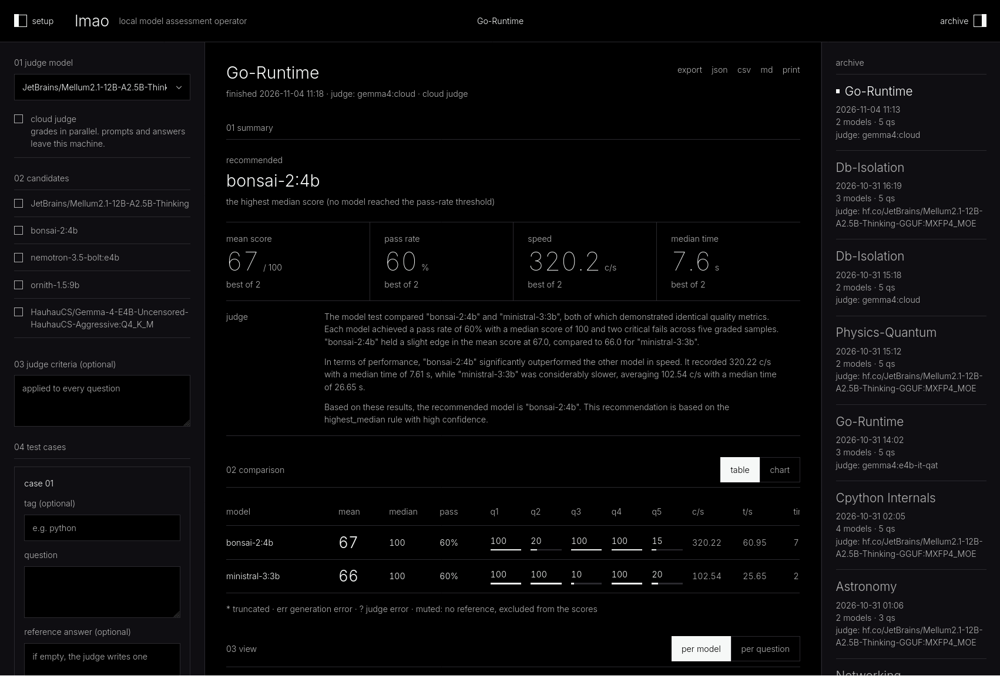

<div align="center">

# lmao

**Local Model Assessment Operator**

Benchmark local LLMs with [Ollama](https://ollama.com): blind grading against a reference, plus speed, ending in a recommendation.

[](https://github.com/kvitkx/lmao/releases)


[](.github/workflows/ci.yml)
[](https://github.com/kvitkx/lmao/actions/workflows/security.yml)
[](https://docs.astral.sh/ruff/)
[](https://github.com/kvitkx/lmao/actions/workflows/release.yml)
[](https://github.com/kvitkx/lmao/pkgs/container/lmao)
[](https://hub.docker.com/r/kvitkx/lmao)
[](https://ollama.com)

<!-- TODO: add a short screen recording (setup -> run -> results) as docs/assets/demo.gif
     and put it above the screenshot:
      -->


</div>

## What it does

Pick a judge model, the candidates and your own questions. lmao runs every candidate through Ollama, has the judge grade each answer blind against a reference, measures speed and recommends the fastest model that is still good enough.

- Blind grading: the judge sees one answer at a time, never model names
- One model loaded at a time, so it fits on a regular GPU (or CPU)
- Scores and the recommendation are computed in code; the judge only writes the summary
- Your own questions with optional reference answers, import and export as JSON
- Run archive, export to JSON, CSV and Markdown
- Local by default; an optional [cloud judge](SECURITY.md) grades in parallel

## How scoring works

The judge writes a reference answer for each question (or you provide one), then grades every answer from 0 to 100 in five bands; 70+ is a pass. The recommendation is the fastest model with a pass rate of at least 80%, otherwise the one with the best median.

## Quick start

You need at least two models in Ollama: one judge and one candidate (they can be the same, but then the score may be biased). Pull them with `ollama pull MODEL_NAME`.

Pick one way to run lmao.

### With make (recommended)

Requires Docker with Compose v2, GNU Make and Bash. NVIDIA Container Toolkit is needed only for GPU mode.

```bash
git clone https://github.com/kvitkx/lmao.git
cd lmao

make prod            # CPU
make prod GPU=1      # NVIDIA GPU
```

Open **http://localhost:5001**. Compose starts the app and Ollama together. Pull the models into that Ollama:

```bash
make pull MODEL=MODEL_NAME
```
Stop with `make down ENV=prod`. Run `make help` to list all commands.

### With Docker

The official lmao image is available on [Docker Hub](https://hub.docker.com/r/kvitkx/lmao) as `kvitkx/lmao` and on GHCR as `ghcr.io/kvitkx/lmao`. Both registries carry the same image (same digest). The Docker Hub page also has a Docker Compose example and the list of tags.

If Ollama runs on your machine:

```bash
docker run -d --name lmao \
  -p 127.0.0.1:5000:5000 \
  -e OLLAMA_BASE_URL=http://host.docker.internal:11434 \
  --add-host=host.docker.internal:host-gateway \
  -v lmao_history:/app/history \
  kvitkx/lmao:latest
```

Open **http://localhost:5000**. Stop with `docker stop lmao`.

- `--add-host` is needed on Linux; Docker Desktop on macOS and Windows resolves `host.docker.internal` on its own.
- On Linux, Ollama must accept connections from the Docker bridge: start it with `OLLAMA_HOST=0.0.0.0`. Keep that port closed to your network.
- To pull from GHCR, use `ghcr.io/kvitkx/lmao:latest` instead of `kvitkx/lmao:latest`.
- Tags: `latest`, `X.Y` (for example `2.2`) and exact `X.Y.Z`. See the [releases](https://github.com/kvitkx/lmao/releases).
- Verify the image: `gh attestation verify oci://ghcr.io/kvitkx/lmao:latest --repo kvitkx/lmao` (for Docker Hub: `oci://docker.io/kvitkx/lmao:latest`)

### With uv

Requires [uv](https://docs.astral.sh/uv/) and a running Ollama. uv installs the right Python (3.15) for you. The stylesheet, Alpine and the fonts are built in Docker, so you also need Docker and GNU Make: the first `make run` builds them, later runs rebuild them only after a template, a script or `static/css/input.css` changes. Without Docker the page has no styles.

```bash
git clone https://github.com/kvitkx/lmao.git
cd lmao

make run
```

Open **http://localhost:5000**. If Ollama is not on `http://localhost:11434`, set `OLLAMA_BASE_URL` (see `.env.example`).

### Where results are stored

Every run is saved in `./history` (make dev, uv), in the `history_data` Docker volume (make prod) or in the volume you mounted at `/app/history` (Docker).

## Development

```bash
make dev                              # hot reload and css rebuild on http://localhost:5000
make run                              # run on the host with uv (builds the css when needed)
make test                             # Python and JS tests, quick (no coverage)
make ci                               # everything GitHub CI runs
```

See [CONTRIBUTING](CONTRIBUTING.md) for commits, branches, PRs and releases, and [DESIGN](DESIGN.md) for the UI.

## Security

lmao is a local tool for one trusted user and has no authentication. Do not expose its port to a network. Details and how to report a vulnerability: [SECURITY](SECURITY.md).

## License

[MIT](LICENSE)