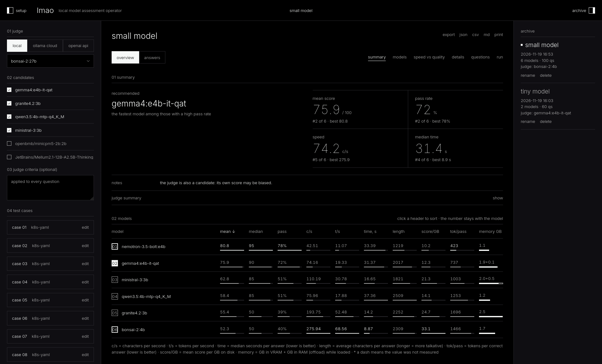

<div align="center">

# lmao

**Local Model Assessment Operator**

Benchmark local LLMs with [Ollama](https://ollama.com): blind grading against a reference, plus speed, ending in a recommendation.

[](https://github.com/kvitkx/lmao/releases)


[](.github/workflows/ci.yml)
[](https://github.com/kvitkx/lmao/actions/workflows/security.yml)
[](https://docs.astral.sh/ruff/)
[](https://github.com/kvitkx/lmao/actions/workflows/release.yml)
[](https://github.com/kvitkx/lmao/pkgs/container/lmao)
[](https://hub.docker.com/r/kvitkx/lmao)
[](https://ollama.com)

<!-- TODO: add a short screen recording (setup -> run -> results) as docs/assets/demo.gif
     and put it above the screenshot:
      -->


</div>

## What it does

Pick a judge model, the candidates and your own questions. lmao runs every candidate through Ollama, has the judge grade each answer blind against a reference, measures speed and recommends the fastest model that is still good enough.

- Blind grading: the judge sees one answer at a time, never model names
- One model loaded at a time, so it fits on a regular GPU (or CPU)
- Scores and the recommendation are computed in code; the judge only writes the summary
- Your own questions with optional reference answers, import and export as JSON
- Stop a run at any time and resume it later, also after a restart
- Run archive, export to JSON, CSV and Markdown
- Local judge by default; an Ollama cloud or OpenAI-compatible judge is optional

The judge grades every answer from 0 to 100 in five bands; 70+ is a pass. The recommendation is the fastest model that passes at least 70% of its answers, otherwise the one with the best median.

## Quick start

You need [Ollama](https://ollama.com) models: at least one judge and one candidate (they can be the same model, but then the score may be biased). With the setup below, Ollama runs next to lmao and you pull models into it.

Requires Docker with Compose v2, GNU Make and Bash. The NVIDIA Container Toolkit is needed only for GPU mode.

```bash
git clone https://github.com/kvitkx/lmao.git
cd lmao

make prod            # CPU
make prod GPU=1      # NVIDIA GPU

make pull MODEL=MODEL_NAME
```

Open **http://localhost:5001**. Stop with `make down ENV=prod`; `make help` lists every command.

Other ways to run:

- **Docker image** (no clone, your own Ollama): [Docker Hub](https://hub.docker.com/r/kvitkx/lmao) has the `docker run` command, a Compose file, the tags and how to verify the image. The same image is on `ghcr.io/kvitkx/lmao`.
- **On the host with uv**: see [CONTRIBUTING](CONTRIBUTING.md).

Everything the server stores (run history, saved connection) lives in one folder, `data/`: `./data` in dev and with uv, a Docker volume otherwise.

## Remote judge

The judge is local by default. The `judge` tab in the setup panel also offers:

- **ollama cloud**: an Ollama cloud model (its name ends in `-cloud`).
- **openai api**: any OpenAI-compatible endpoint (OpenAI, OpenRouter, vLLM, LM Studio). Add a connection: base URL, API key, judge model and, optionally, prices per million tokens for the cost estimate. `test` checks the model list, structured output and seed support.

A remote judge grades in parallel. Before a run the start screen shows where the data goes, an estimate of calls, tokens and cost, and the exact request of one grading call. Questions, criteria, reference answers and candidate answers leave your machine, never the candidate model names. The key stays on the server and is never sent back to the browser. Details: [SECURITY](SECURITY.md).

## More

- [CONTRIBUTING](CONTRIBUTING.md): development, checks, commits and releases
- [DESIGN](DESIGN.md): the interface
- [SECURITY](SECURITY.md): security model and reporting a vulnerability. lmao is a local tool for one trusted user with no authentication: do not expose its port to a network.
- [Docker Hub](https://hub.docker.com/r/kvitkx/lmao) · [Releases](https://github.com/kvitkx/lmao/releases)

## License

[MIT](LICENSE)